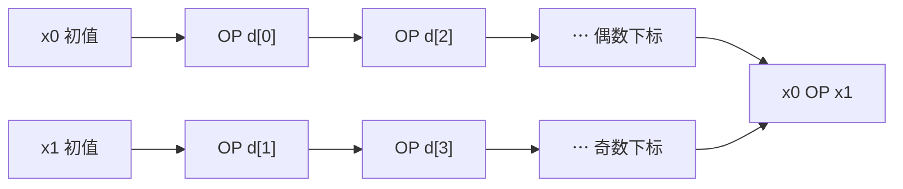

---
# You can also start simply with 'default'
theme: academic
# random image from a curated Unsplash collection by Anthony
# like them? see https://unsplash.com/collections/94734566/slidev
# background: bg.jpg
# some information about your slides (markdown enabled)
title: "05-Compilation"
highlighter: shiki
info: |
  ICS 2026 Fall Slides
# apply unocss classes to the current slide
presenter: true
class: text-center
# https://sli.dev/features/drawing
titleTemplate: '%s'
drawings:
  persist: false
# slide transition: https://sli.dev/guide/animations.html#slide-transitions
transition: fade-out
# enable MDC Syntax: https://sli.dev/features/mdc
mdc: true
fonts:
  sans: '"", "华文中宋", "宋体"'
  serif: '"Consolas", "华文中宋", "宋体"'
  mono: '"Consolas", "华文中宋", "宋体"'

lineNumbers: true

layout: cover
coverBackgroundUrl: /05-Compilation/cover.jpg
---
# Compilation

Menghong Yu, EECS, PKU

<style>
  div{
   @apply text-gray-2;
  }
</style>

---

# 程序优化

Program Optimization

- 本章主要关注优化处理器执行程序的性能（Performance）
- 而不是优化程序的时间复杂度
  - 例如排序：冒泡排序 $O(n^2)$ 与快排平均 $O(n\log n)$
- 而是想办法让处理器执行程序的速度更快
  - 例如减少函数调用/提升指令并行度……
  - 实际上是在做**常数优化**
- 常数也可以产生很大的影响！
  - 例如矩阵乘法，实现得不好的可能会慢上几十倍！

---

# 机器无关优化

target-independent

- 一句话原则：**只要有出错的可能就不做优化**
  - 不能改变程序的行为
  - 保守
- 代码移动（识别要执行多次但计算结果不会改变的计算）
  - 例如字符串的 `strlen`，$O(n^2)$？
- 减少过程调用
- 消除不必要的内存引用
  - 访存还是很耗时的

---

# 理解现代处理器

modern CPU

- 延迟、发射时间、容量、吞吐率
  - 辨析概念，书本 p361
- 数据流图与关键路径
  - 理解循环展开的关键
- $k\times k$ 循环展开：$k$ 路，$k$ 个累积变量。
- 循环展开的路数越多不一定效果越好。


---

# 代码移动：把不变的计算移出循环

<div grid="~ cols-2 gap-8">
<div>

优化前：

<div class="optimization-diff">

```c {2}
for (long j = 0; j < n; j++)
  a[n * i + j] = b[j];
```

</div>

</div>
<div class="text-[17px] leading-normal">

优化后：

<div class="optimization-diff">

```c {1,3}
long ni = n * i;
for (long j = 0; j < n; j++)
  a[ni + j] = b[j];
```

</div>

</div>
</div>

- 循环中只有 `j` 改变，`n * i` 每次的结果相同，可以提前计算。
- 编译器还可以提前算出行首指针 `double *row = a + ni`。
- 判断依据：移出循环后，计算结果与程序行为保持不变。

<!--
参考：ICS14-optimization-20261102.pdf，第 6–7 页。
-->

---

# 强度削减：用递增代替重复乘法

<div grid="~ cols-2 gap-8">
<div>

逐行计算起始位置：

<div class="optimization-diff">

```c {2}
for (long i = 0; i < n; i++) {
  long ni = n * i;
  for (long j = 0; j < n; j++)
    a[ni + j] = b[j];
}
```

</div>

</div>
<div class="text-[17px] leading-normal">

利用相邻行相差 n 个元素：

<div class="optimization-diff">

```c {1,5}
long ni = 0;
for (long i = 0; i < n; i++) {
  for (long j = 0; j < n; j++)
    a[ni + j] = b[j];
  ni += n;
}
```

</div>

</div>
</div>

- 地址依次为 $0,n,2n,3n,\ldots$，可以通过加法逐次生成。
- 指针递增也是常见形式：用 `p++` 推进到下一个元素。
- 是否更快取决于目标机器；这类简单变换通常也能由编译器完成。

<!--
参考：ICS14-optimization-20261102.pdf，第 8 页。
-->

---

# 公共子表达式：复用共同的基址

<div grid="~ cols-2 gap-8">
<div>

求矩阵中一个元素的四个邻居：

<div class="optimization-diff">

```c {1-4}
up    = val[(i - 1) * n + j];
down  = val[(i + 1) * n + j];
left  = val[i * n + j - 1];
right = val[i * n + j + 1];
sum = up + down + left + right;
```

</div>

</div>
<div class="text-[17px] leading-normal">

先计算共同的基址：

<div class="optimization-diff">

```c {1-5}
long pos = i * n + j;
up    = val[pos - n];
down  = val[pos + n];
left  = val[pos - 1];
right = val[pos + 1];
sum = up + down + left + right;
```

</div>

</div>
</div>

- 将重复的地址计算合并，让 `i * n + j` 只计算一次。
- 编译器既可以复用完全相同的表达式，也可以识别这种地址关系。

<!--
参考：ICS14-optimization-20261102.pdf，第 9 页。
-->

---

# 优化例子：冒泡排序

<div grid="~ cols-2 gap-8">
<div>

原始写法：

<div class="optimization-diff">

```c {2-6}
for (long end = n - 1; end > 0; end--)
  for (long j = 0; j < end; j++)
    if (a[j] > a[j + 1]) {
      int t = a[j];
      a[j] = a[j + 1];
      a[j + 1] = t;
    }
```

</div>

</div>
<div class="text-[17px] leading-normal">

复用读出的值，并递增指针：

<div class="optimization-diff">

```c {2-7}
for (long end = n - 1; end > 0; end--) {
  int *last = a + end;
  for (int *p = a; p < last; p++) {
    int x = p[0], y = p[1];
    if (x > y) {
      p[0] = y;
      p[1] = x;
    }
  }
}
```

</div>

</div>
</div>

- 比较时已经读出两个元素，交换时可以直接复用；相邻地址用指针递增生成。
- 排序算法仍是冒泡排序；减少的是地址计算、重复加载等内循环开销。

<!--
参考：ICS14-optimization-20261102.pdf，第 10–18 页。
-->

---

# 过程调用：循环里的 strlen

<div grid="~ cols-2 gap-8">
<div>

每次判断循环条件都调用：

<div class="optimization-diff">

```c {2}
void lower1(char *s) {
  for (size_t i = 0; i < strlen(s); i++)
    if (s[i] >= 'A' && s[i] <= 'Z')
      s[i] += 'a' - 'A';
}
```

</div>

</div>
<div class="text-[17px] leading-normal">

字符串长度在转换过程中不变：

<div class="optimization-diff">

```c {2-3}
void lower2(char *s) {
  size_t len = strlen(s);
  for (size_t i = 0; i < len; i++)
    if (s[i] >= 'A' && s[i] <= 'Z')
      s[i] += 'a' - 'A';
}
```

</div>

</div>
</div>

- `strlen(s)` 扫描到字符串末尾，每次需要 $O(n)$ 时间。
- 左边调用约 $n$ 次，整体为 $O(n^2)$；右边只扫描一次，整体为 $O(n)$。
- 关键是消除隐藏的重复工作，不能只数代码中显式写出的循环层数。

<!--
参考：ICS14-optimization-20261102.pdf，第 21–26 页。
-->

---

# 编译器为什么不能总替你移动函数调用

<div grid="~ cols-2 gap-8">
<div>

<div class="optimization-diff">

```c {7}
size_t lencnt = 0;

size_t my_strlen(const char *s) {
  size_t len = 0;
  while (s[len] != '\0')
    len++;
  lencnt += len;  // 修改全局状态
  return len;
}
```

</div>

</div>
<div class="text-[17px] leading-normal">

- 返回值相同，不代表函数没有副作用。

- 如果把多次 `my_strlen` 调用合并成一次，`lencnt` 的最终结果就会改变。

- 即使函数本身无副作用，循环中的写入也可能改变下一次调用读取的内容。

- 让编译器看到函数实现，有助于分析和内联；程序员也可以显式提前计算不变的结果。

</div>
</div>

优化必须保持程序行为；编译器无法证明安全时，就需要保守处理。{.text-sky-5}

<!--
参考：ICS14-optimization-20261102.pdf，第 20、27 页。
-->

---

# 内存别名：为什么不能省掉写入

<div grid="~ cols-2 gap-8">
<div>

<div class="optimization-diff">

```c {4,6}
void sum_rows1(double *a, double *b,
               long n) {
  for (long i = 0; i < n; i++) {
    b[i] = 0;
    for (long j = 0; j < n; j++)
      b[i] += a[i * n + j];
  }
}
```

</div>

</div>
<div class="text-[17px] leading-normal">

- `a` 指向矩阵，`b` 指向每一行的和。

- 内循环每轮都要读写 `b[i]`，而不是只在寄存器中累加。

- **内存别名（aliasing）**：不同的指针或表达式，可能访问同一个内存位置。

- 若 `b[i]` 正好也是矩阵中的某个元素，写入 `b[i]` 就会改变后续读取的 `a[...]`。

</div>
</div>

因此，编译器不能无条件把这些读写全部移到循环外。

<!--
参考：ICS14-optimization-20261102.pdf，第 28–29 页。
-->

---

# 别名反例：输出向量位于输入矩阵内部

<div grid="~ cols-2 gap-8">
<div>

<div class="optimization-diff">

```c {6}
double A[9] = {
   0,  1,   2,
   4,  8,  16,
  32, 64, 128
};
double *B = A + 3;

sum_rows1(A, B, 3);
```

</div>

</div>
<div class="text-[17px] leading-normal">

<div class="text-[16px]">

| 执行进度 | B 的内容 |
| :--- | :--- |
| 初始 | `[4, 8, 16]` |
| 第 0 行结束 | `[3, 8, 16]` |
| 第 1 行结束 | `[3, 22, 16]` |
| 第 2 行结束 | `[3, 22, 224]` |

</div>

</div>
</div>

- 计算第 1 行时，先将 `B[1]`（即 `A[4]`）清零。
- 随后累加：$0+3=3$；再读 `A[4]` 时读到的是刚写入的 3，因此得到 $3+3+16=22$。
- 中间写入确实会影响后续读取，不能随意省掉。

<!--
参考：ICS14-optimization-20261102.pdf，第 29 页。
-->

---

# 用局部变量消除不必要的内存引用

<div grid="~ cols-2 gap-8">
<div>

<div class="optimization-diff">

```c {4,6-7}
void sum_rows2(double *a, double *b,
               long n) {
  for (long i = 0; i < n; i++) {
    double sum = 0;
    for (long j = 0; j < n; j++)
      sum += a[i * n + j];
    b[i] = sum;
  }
}
```

</div>

</div>
<div class="text-[17px] leading-normal">

- 在 `a` 与 `b` 不重叠的用法中，可以先在局部变量中累加。

- 内循环每轮只读一个矩阵元素；每一行结束时才写一次 `b[i]`。

- `sum` 可放在寄存器中，避免反复加载、存储中间结果。

- 若沿用上一页的重叠输入，本版本得到 `[3, 27, 224]`，与原版本不同。

</div>
</div>

这是程序员根据实际数据关系作出的改写；编译器不能无条件用它替换原版本。{.text-sky-5}

<!--
参考：ICS14-optimization-20261102.pdf，第 30–31 页。
-->

---

# 用 CPE 衡量向量程序的性能

<div grid="~ cols-2 gap-8">
<div>

<div class="optimization-diff">

```c {2-6}
void combine1(vec_ptr v, data_t *dest) {
  *dest = IDENT;
  for (long i = 0; i < vec_length(v); i++) {
    data_t val;
    get_vec_element(v, i, &val);
    *dest = *dest OP val;
  }
}
```

</div>

</div>
<div class="text-[17px] leading-normal">

**向量归约**：将所有元素相加或相乘。

- `OP` 为 `+` 时，`IDENT = 0`。
- `OP` 为 `*` 时，`IDENT = 1`。
- `get_vec_element` 还包含边界检查。

**CPE（Cycles Per Element）**：平均处理一个元素所需的时钟周期数。

</div>
</div>

$$
T(n) \approx \mathrm{CPE}\cdot n + T_{\mathrm{overhead}}
$$

固定开销之外，CPE 是“总周期数随元素数增长”的斜率，越小越好。

<!--
参考：ICS14-optimization-20261102.pdf，第 34–37 页。
-->

---

# 基础优化：combine1 → combine4

<div grid="~ cols-2 gap-8">
<div>

<div class="optimization-diff">

```c {2-7}
void combine4(vec_ptr v, data_t *dest) {
  long n = vec_length(v);
  data_t *d = get_vec_start(v);
  data_t x = IDENT;
  for (long i = 0; i < n; i++)
    x = x OP d[i];
  *dest = x;
}
```

</div>

</div>
<div class="text-[17px] leading-normal">

- 将长度计算移出循环。

- 直接访问数据数组，减少取元素的函数调用和重复边界检查。

- 输出不覆盖输入时，用寄存器中的 `x` 累加，循环结束后才更新 `*dest`。

</div>
</div>

<div class="text-[16px]">

<div>讲义中的测量结果（CPE）：</div>

| 版本 | 整数加 | 整数乘 | double 加 | double 乘 |
| :--- | :---: | :---: | :---: | :---: |
| combine1，未优化 | 22.68 | 20.02 | 19.98 | 20.18 |
| combine1，-O1 | 10.12 | 10.12 | 10.17 | 11.14 |
| combine4 | **1.27** | **3.01** | **3.01** | **5.01** |

</div>

<!--
参考：ICS14-optimization-20261102.pdf，第 35–39 页。
-->

---

# 超标量与执行单元的流水化

- **超标量**：同一周期可发射、执行多条指令，利用多个执行单元并行工作。
- **执行单元流水化**：一次运算分为多级，不同运算可以在不同级重叠进行。

下面只用一个三阶段乘法单元，计算 `p1 = a*b`、`p2 = a*c`、`p3 = p1*p2`：

<div class="text-[16px]">

| 阶段 / 周期 | 1 | 2 | 3 | 4 | 5 | 6 | 7 |
| :--- | :---: | :---: | :---: | :---: | :---: | :---: | :---: |
| 第 1 级 | a*b | a*c | | | p1*p2 | | |
| 第 2 级 | | a*b | a*c | | | p1*p2 | |
| 第 3 级 | | | a*b | a*c | | | p1*p2 |

</div>

- 单次乘法需要 3 个周期，但独立乘法可以每周期启动一次。
- `p3` 必须等 `p1`、`p2` 都算完，因此直到第 5 周期才能启动。

<!--
参考：ICS14-optimization-20261102.pdf，第 40–42 页。
-->

---

# 动态调度：Scoreboard（记分牌）

集中记录状态，决定指令何时读取操作数、执行和写回。


<div class="text-[18px] leading-normal">

- **读图**：左表记录指令进度，中表记录功能单元和操作数状态，右表记录哪个单元将写入寄存器。
- **动态调度**：等数据的指令先等待；无依赖、资源可用的就绪指令可以先执行。
- **限制**：不做寄存器重命名，名称冲突（WAR / WAW）仍需通过停顿处理。

</div>

<!--
图：项目已有 public/05-Compilation/ScoreBoard.png。
参考：University of Washington，Scoreboard / Tomasulo 课程讲义，第 13–16 页：
https://courses.cs.washington.edu/courses/csep548/00sp/lectures/class10.pdf
-->

---

# 动态调度：Tomasulo

用保留站保存待执行的指令，用 Tag 跟踪操作数来自哪一次计算。

<div grid="~ cols-5 gap-6" class="items-center">
<div class="col-span-3">


</div>
<div class="col-span-2 text-[17px] leading-normal">

- **保留站（RS）**：保存指令和已有操作数；数据未到时，用 Tag 记下“等谁的结果”。

- **寄存器重命名**：用不同 Tag 区分同名寄存器的不同次结果，消除 WAR / WAW 名称冲突。

- **结果广播（CDB）**：结果连同 Tag 广播，等待它的保留站接收后，操作数便准备好了。

</div>
</div>

真正的数据依赖（RAW）仍需等待结果。{.text-sky-5}

<!--
图：项目已有 public/05-Compilation/Tumasulo.png；图内部分数字是该示例的配置。
参考：Duke ECE 252，Dynamic Scheduling I，第 33 页及后续 Tomasulo 讲解：
https://people.ee.duke.edu/~sorin/ece252/lectures/4.2-tomasulo.pdf
-->

---

# 延迟、发射间隔、容量与吞吐率

- **延迟 D**：从启动运算到结果可用，需要多少个周期。
- **发射间隔 I**：同一个执行单元接收两次运算，至少间隔多少个周期。
- **容量 M**：有多少个执行单元能够完成这种运算。
- 操作数相互独立时，理想吞吐率为 $M/I$ 次运算 / 周期。

<div class="text-[16px]">

讲义中的 Haswell 示例：

| 运算 | 延迟 D | 发射间隔 I | 单元数 M | 理想吞吐率 |
| :--- | :---: | :---: | :---: | :---: |
| 整数加法 | 1 | 1 | 4 | 4 次 / 周期 |
| 整数乘法 | 3 | 1 | 1 | 1 次 / 周期 |
| double 加法 | 3 | 1 | 1 | 1 次 / 周期 |
| double 乘法 | 5 | 1 | 2 | 2 次 / 周期 |

</div>

<!--
参考：ICS14-optimization-20261102.pdf，第 41–43、49 页。
-->

---

# 数据依赖与关键路径

<div class="optimization-diff">

```c {2-3}
data_t x = IDENT;
for (long i = 0; i < n; i++)
  x = x OP d[i];
```

</div>


- 每次运算都需要上一次更新后的 `x`，形成一条串行依赖链。
- **关键路径**是必须依次完成、累计延迟最长的依赖路径；它限制总执行时间。
- 若一次 `OP` 的延迟为 $D$，这条链约需 $nD$ 个周期，因而 $\mathrm{CPE} \gtrsim D$。
- 即使还有空闲执行单元，也无法提前启动依赖尚未满足的下一次累加。

<!--
参考：ICS14-optimization-20261102.pdf，第 44–45 页。
-->

---

# 循环展开：2×1

<div grid="~ cols-2 gap-8">
<div>

<div class="optimization-diff">

```c {3-4}
data_t x = IDENT;
long i = 0;
for (; i < n - 1; i += 2)
  x = (x OP d[i]) OP d[i + 1];

for (; i < n; i++)
  x = x OP d[i];
*dest = x;
```

</div>

</div>
<div class="text-[17px] leading-normal">

- 每次循环处理 **2 个元素**，但只有 **1 个累加器**。

- 减少循环条件判断、索引更新和跳转的次数。

- 尾循环处理剩余的一个元素，避免漏算或越界。

- 运算仍按原顺序依赖同一个 `x`；依赖链中的运算次数没有减少。

</div>
</div>

讲义中的 double 乘法：CPE 仍约为 5。单纯展开没有解除乘法的串行依赖。

<!--
参考：ICS14-optimization-20261102.pdf，第 46–47 页。
-->

---

# 重新结合：2×1a

<div grid="~ cols-2 gap-8">
<div class="text-[17px] leading-normal">

保持左结合：

<div class="optimization-diff">

```c {1}
x = (x OP d[i]) OP d[i + 1];
```

</div>

改为先计算一对元素：

<div class="optimization-diff">

```c {1}
x = x OP (d[i] OP d[i + 1]);
```

</div>

- `d[i] OP d[i+1]` 不依赖之前的 `x`，可以提前计算。
- 累加器依赖链每处理两个元素，只需经过一次 `OP`。
- 依赖链的长度约减半，延迟下界从 $D$ 降到 $D/2$。

</div>
<div>


<div class="text-sm text-center mt-2">

图以乘法为例：绿色先计算元素对，粉色更新累加器。

</div>
</div>
</div>

其余展开循环和尾循环与 2×1 相同。讲义中的 double 乘法 CPE 从约 5 降至约 2.5。

<!--
参考：ICS14-optimization-20261102.pdf，第 48–50 页。
-->

---

# 重新结合为什么可能改变浮点结果

浮点运算有舍入，**加法、乘法一般不满足结合律**。

<div grid="~ cols-2 gap-8">
<div>

<div class="optimization-diff">

```c {5-6}
double a = 1e20;
double b = -1e20;
double c = 3.14;

double x = (a + b) + c;  // 约 3.14
double y = a + (b + c);  // 约 0
```

</div>

</div>
<div class="text-[17px] leading-normal">

- 左边先计算 `a + b`，得到 0，再加上 3.14。

- 右边先计算 `b + c`，小的 3.14 被舍入掉；再与 `a` 相加，得到 0。

- 重新结合和多个累加器会改变浮点运算的顺序，因此编译器不能在要求保持原语义时任意改写。

</div>
</div>

采用这类优化前，需要确认应用允许相应的浮点误差变化。

<!--
参考：ICS14-optimization-20261102.pdf，第 33、48 页。
-->

---

# 多个累加器：2×2

<div grid="~ cols-2 gap-8">
<div class="text-[17px] leading-normal">

<div class="optimization-diff">

```c {1,3-5,8-9}
data_t x0 = IDENT, x1 = IDENT;
long i = 0;
for (; i < n - 1; i += 2) {
  x0 = x0 OP d[i];
  x1 = x1 OP d[i + 1];
}
for (; i < n; i++)
  x0 = x0 OP d[i];
*dest = x0 OP x1;
```

</div>

- 每次循环处理 **2 个元素**，使用 **2 个独立累加器**。
- `x0` 处理偶数下标，`x1` 处理奇数下标；最后再合并。
- 两条依赖链之间没有依赖，可以交错执行。
- 每条链约有 $n/2$ 次运算，延迟下界约为 $D/2$。

</div>
<div>


<div class="text-sm text-center mt-2">

图以乘法为例：两条独立的累加链最后合并。

</div>
</div>
</div>

与 2×1 相比，关键变化是增加独立的累加器，让更多运算能够并行。

<!--
参考：ICS14-optimization-20261102.pdf，第 51–53 页。
-->

---

# 两个累加器对应两条独立的数据流



- 一条链等待结果时，处理器可以推进另一条链。
- 对延迟为 5 个周期的乘法，两个累加器将依赖限制降至约 **2.5 CPE**。
- 继续增加独立链，可以进一步隐藏延迟；最终仍会遇到执行单元或加载的吞吐率限制。

<!--
参考：ICS14-optimization-20261102.pdf，第 51–54 页。
-->

---

# 展开 L 路、使用 K 个累加器

- **展开因子 L**：一次循环处理多少个元素。
- **累加器数 K**：把计算分成多少条独立依赖链；讲义的均匀分配方案取 $L$ 为 $K$ 的倍数。

$$
\mathrm{CPE}\gtrsim\max\left(\frac{D}{K},\frac{I}{M},\mathrm{CPE}_{\mathrm{load}}\right)
$$

<div class="text-[16px]">

讲义中的 Haswell double 乘法（D = 5，每周期最多发射 2 次乘法、加载 2 个元素）：

| 展开 L / 累加器 K | 1 / 1 | 2 / 2 | 4 / 4 | 8 / 8 | 10 / 10 | 12 / 12 |
| :--- | :---: | :---: | :---: | :---: | :---: | :---: |
| 实测 CPE | 5.01 | 2.51 | 1.25 | 0.63 | 0.51 | 0.52 |

</div>

- 本例下界为 $\max(5/K,0.5)$，约 10 个累加器时接近吞吐率极限。
- 展开更多不一定更快：还有尾循环、代码体积和寄存器压力等开销。

<!--
参考：ICS14-optimization-20261102.pdf，第 54–56 页。
-->

---

# 循环展开的性能对比

<div class="text-[16px]">

<div>讲义中的 Haswell 标量测量，单位为 CPE（越小越好）：</div>

| 版本 | 整数加 | 整数乘 | double 加 | double 乘 |
| :--- | :---: | :---: | :---: | :---: |
| combine4 | 1.27 | 3.01 | 3.01 | 5.01 |
| 2×1：只展开 | 1.01 | 3.01 | 3.01 | 5.01 |
| 2×1a：重新结合 | 1.01 | 1.51 | 1.51 | 2.51 |
| 2×2：双累加器 | 0.81 | 1.51 | 1.51 | 2.51 |
| 讲义中最佳标量实现 | **0.54** | **1.01** | **1.01** | **0.52** |
| 吞吐率下界 | 0.50 | 1.00 | 1.00 | 0.50 |

</div>

- 只展开主要减少循环开销；改变数据依赖，才能突破原来的延迟限制。
- 即使整数加法单元足够多，每周期只能加载 2 个元素，也使本例 CPE 难低于 0.5。

<!--
参考：ICS14-optimization-20261102.pdf，第 47、49、52、57 页。
-->

---

# SIMD：一条指令处理多个元素

**SIMD（Single Instruction, Multiple Data）**：同一条指令对多个元素分别执行相同操作。

在 x86-64 的 AVX2 中，一个 YMM 寄存器为 **256 位（32 字节）**：

<div grid="~ cols-2 gap-8">
<div>

<div class="text-[16px]">

| 数据类型 | 每个 YMM 中的元素数 |
| :--- | :---: |
| float（32 位） | 8 |
| double（64 位） | 4 |

</div>

对应的向量加法：

```asm
vaddps %ymm0, %ymm1, %ymm1
vaddpd %ymm0, %ymm1, %ymm1
```

</div>
<div class="text-[16px]">

讲义实测 CPE，按原数组的标量元素计：

| 实现 | 整数加 | 整数乘 | 浮点加 | 浮点乘 |
| :--- | :---: | :---: | :---: | :---: |
| 最佳标量 | 0.54 | 1.01 | 1.01 | 0.52 |
| 最佳向量 | **0.06** | **0.24** | **0.25** | **0.16** |

浮点列均为 double。

</div>
</div>

SIMD 扩大每条指令处理的数据量；循环展开和多个累加器仍可继续用于隐藏指令延迟。

<!--
参考：ICS14-optimization-20261102.pdf，第 58–60 页。
-->

---

# 补充：Rust 与优化阻碍

- **副作用（Side effects）**：Rust 允许定义全局变量，但读取或写入可变全局变量 static mut 需要 unsafe。

- **别名约束（Aliasing）**：借用的基本规则是，同一时刻，对同一份数据二选一：
  - **一个可变引用 `&mut T`**，提供独占的读写访问；
  - **多个共享引用 `&T`**，提供共享的只读访问。

- **优化意义**：更明确的别名约束，有助于编译器分析内存依赖，消除不必要的访存并安排指令执行。

> 觉得这样做很不优美? 有没有在不影响写法的情况下就客服Aliasing的方法呢? 

> 我们将在Concurrency一节讲述我目前的主要研究方向: Separation Logic, 以及获得了2015年哥德尔奖的成果Concurrent Separation Logic(CSL)
<!--
这里介绍普通数据的基本借用规则；内部可变性等机制不在本页展开。
参考：The Rust Programming Language，References and Borrowing：
https://doc.rust-lang.org/book/ch04-02-references-and-borrowing.html
参考：Rust static 关键字文档：
https://doc.rust-lang.org/stable/core/keyword.static.html
-->

---

# 补充：E-graph 与等式饱和

《egg: Fast and Extensible Equality Saturation》{.text-sm}


<div class="text-[17px] leading-normal">

- **重写顺序**：先用哪条规则，可能影响之后还能做哪些优化。
- **E-graph**：用等价类和共享结构，紧凑地保留多种等价表达式；图中虚线框表示等价类。
- **等式饱和（Equality saturation）**：反复加入重写得到的等价形式，最后按成本模型，从已有候选中提取更优的实现。

</div>

每条重写规则都必须符合目标语言的数值语义。{.text-sm.text-sky-5}

<!--
图：项目已有 public/05-Compilation/Egraph.png，egg 论文中的示例；按图示重写成立的代数语义理解，不直接视为任意 C 整数或浮点表达式都成立的规则。
参考：Willsey et al., egg: Fast and Extensible Equality Saturation (POPL 2021)：
https://arxiv.org/abs/2004.03082
参考：egg 官方教程 Background：
https://github.com/egraphs-good/egg/blob/main/src/tutorials/_01_background.rs
-->

---

# 链接

Linking

**链接**：将多个目标文件组合成一个可执行文件。

**目标文件**：编译器将源代码文件编译后的产物，但还未链接成最终的可执行文件。

**可执行文件**：链接后的最终产物，这个文件可被加载（复制）到内存并执行。

链接在 **编译时、加载时、运行时** 均可执行（后文会说都是啥）。

链接的优势：

- **代码模块化**：方便查找问题与维护，可以建立常见函数的库
- **时间和空间效率**：只需要改一处代码可同时影响多个代码，只会编译你引用的库中用到的代码


<!-- 

这章确实翻译的一坨，看书体验很差。

 -->

---

# 从源代码到可执行文件

From source code to executable file

```text
main.c → 预处理 → main.i → 编译 → main.s → 汇编 → main.o ─┐
add.c  → 预处理 → add.i  → 编译 → add.s  → 汇编 → add.o  ─┼→ 链接 → demo
data.c → 预处理 → data.i → 编译 → data.s → 汇编 → data.o ─┘
```

$$
\text{.c} \xrightarrow{\text{cpp}} \text{.i} \xrightarrow{\text{cc1}} \text{.s} \xrightarrow{\text{as}} \text{.o} \xrightarrow{\text{ld}} \text{prog}
$$

<div class="text-sm">

<v-clicks>


- `gcc`：编译器驱动程序
- `cpp`：C 预处理（c preprocessor），将 xx.c 翻译成一个 ASCII 码的 **中间文件**{.text-sky-5} xx.i（intermediate file）
- `cc1`：C 编译器（c compiler），将 xx.i 翻译成一个 ASCII **汇编语言文件**{.text-sky-5} xx.s（assembly language file）
- `as`：汇编器（assembler），将 xx.s 翻译成一个 **可重定位目标文件**{.text-sky-5} xx.o（relocatable object file）
- `ld`：链接器（linker），将 xx.o 和其他的 xx.o，以及必要的系统目标文件组合起来，创建一个**可执行目标文件**{.text-sky-5} prog

</v-clicks>


</div>


---

# 静态链接

Static Linking：本节始终使用下面这三个源文件

<LinkingDemoSources />


```sh
gcc -g -O0 -c main.c add.c data.c
gcc main.o add.o data.o -o demo
```

- `demo.h` 提供声明；`main.c` 使用 `x/y/add`，`add.c` 和 `data.c` 提供定义。
- 每个 `.c` 分别生成一个 `.o`，再由链接器组合成 `demo`；运行后 `main` 返回 `5`。


---

# 静态链接

Static Linking

在静态链接中，链接器需要实现如下功能：

- **符号解析**{.text-sky-5}：将 **符号引用** 与输入的可重定位目标文件中的 **符号表** 中的一个确定的符号（全局变量、函数等）关联起来。
- **重定位**{.text-sky-5}：**合并重定位输入模块**，将符号定义与一个地址关联起来，并为找到的每个符号指向对应的该地址。

---

# 目标文件

Object File

1. **可重定位目标文件**
   - 这是一个包含计算机能直接理解的代码和数据的文件，**但它还不能单独运行**{.text-sky-5}。
   - 它就像是一个半成品，需要和其他半成品合并在一起才能变成一个完整的产品。
2. **可执行目标文件**
   - 这是一个已经准备好 **可以直接在计算机上运行的文件**{.text-sky-5}。
   - 它就像是一个已经组装好的玩具，拿到手就可以玩了，不需要再做其他操作。
3. **共享目标文件**
   - **特殊类型的可重定位目标文件**{.text-sky-5}，可以在程序运行的时候 **动态加载**{.text-sky-5} 进来使用。
   - 它就像是一个插件，可以在需要的时候装上去，不需要的时候可以取下来。

---

# 可重定位目标文件

Relocatable Object File

<div grid="~ cols-2 gap-12">
<div>

```
ELF 可重定位目标文件
│
├── ELF 头（ELF Header）[低地址]
│
├── 节（Sections）
│   ├── .text（机器代码）
│   ├── .rodata（只读数据）
│   ├── .data（已初始化数据）
│   ├── .bss（未初始化数据）
│   ├── .symtab（符号表）
│   ├── .rela.text（重定位信息）
│   ├── .rela.data（重定位信息）
│   ├── .debug（调试信息）
│   └── .strtab（字符串表）
│
├── 节头部表（Section Header Table）[高地址]
│   ├── 节头部条目 1
│   ├── 节头部条目 2
│   ├── ...
│   └── 节头部条目 N
```

</div>

<div>


</div>
</div>

---

# 链接例子：从 add(x, y) 开始

沿用前面的三个文件：x、y 在 data.c 中定义，bias 只在 add.c 内使用

<LinkingDemoSources />

<div class="linking-table text-[18px] leading-normal mt-5">

| 文件 | 提供的定义 | 需要其他文件提供 |
| --- | --- | --- |
| `main.o` | `main` | `x`、`y`、`add` |
| `add.o` | `add`；私有的 `bias` | 无 |
| `data.o` | `x`、`y` | 无 |

</div>

`x = 2` 放在 .data；`y = 0`、`bias = 0` 放在 .bss。接下来看链接器怎样把这三个文件接起来。{.text-sm.text-sky-5}

<!--
本例沿用本课 C / x86-64 ELF 环境与分离编译模型，省略启动文件等系统组件。
完整代码与动画共用 components/linkingAnimationData.ts 中的定义。
bias 具有内部链接和静态存储期，在 -O0 下便于对应代码与符号信息。
main 的返回值为进程退出状态 5，不是向终端打印字符 5。
-->


---

# .s 到 .o：机器指令和说明一起留下

main.s、add.s、data.s 分别汇编成 main.o、add.o、data.o

<div grid="~ cols-2 gap-10">
<div>

### main.c 中的使用

<div class="optimization-diff">

```c {3-4}
#include "demo.h"
int main(void) {
    y = 3;
    return add(x, y);
}
```

</div>

`x/y` 的定义在 `data.c`，见前页。

</div>
<div class="text-[19px] leading-normal">

### main.o 中已经有

- `main` 的机器指令。
- 符号表：定义 `main`，外部引用 `x/y/add`。
- 重定位记录：哪些指令字段还需修补。

### 还没确定

`x/y/add` 的定义来自哪里，以及代码、数据在最终程序中的位置。

</div>
</div>

ELF 文件同时保存“要运行的内容”和“帮助链接器把它们接起来的说明”。{.text-sm.text-sky-5}

<!--
范围是本课 ELF 工具链。data.o 中 x/y 的输入节及节内位置可确定，最终布局尚待链接。
参考：https://gabi.xinuos.com/elf/03-sheader.html
参考：https://gabi.xinuos.com/elf/06-reloc.html
-->


---
clicks: 6
---

# 动画：三个 .c 分别生成怎样的 ELF？

沿用同一组 main.c、add.c、data.c，逐个展开代码、数据和链接说明

<ElfBuildAnimation :step="$clicks" @click.stop="$nav.next()" />

<!--
本页与前后代码共用同一组三文件例子；demo.h 提供 add 的函数声明与 x/y 的 extern 声明。
每个 .o 分两步展示“代码/数据”和“链接说明”，只是讲解顺序，不宣称汇编器实际分两遍工作。
仅显示相关节；省略调试节、其他元数据及具体文件偏移。data.o 没有本例需修补的地址引用，不绘制虚构的 .rela.text。
源代码与展示数据统一定义在 components/linkingAnimationData.ts。
参考：https://gabi.xinuos.com/elf/03-sheader.html
参考：https://gabi.xinuos.com/elf/05-symtab.html
参考：https://gabi.xinuos.com/elf/06-reloc.html
-->


---

# 如何从 ELF 中找到符号信息？

沿用 add.o：先找到表的位置，再读取表里的记录

<div grid="~ cols-2 gap-10">
<div class="text-[19px] leading-relaxed">

1. **读 ELF 头**：用 `e_shoff` 找到节头部表。
2. **读节头部表**：找到 `.symtab` 的文件位置，以及其中每条记录的大小。
3. **找关联的字符串表**：`.symtab` 的节头条目中，`sh_link` 指向它使用的 `.strtab`。

现在就能逐条读符号记录，并到字符串表里取出对应的名字。

</div>
<div>

### add.o 中的目录关系（示意）

```text
ELF 头
  e_shoff → 节头部表

节号  节名        文件位置
 1    .text      ...
 2    .bss       ...
 3    .symtab    ...
 4    .strtab    ...

.symtab 的 sh_link = 4
       → 使用第 4 个节的字符串表
```

</div>
</div>

.strtab 保存符号名；.shstrtab 保存 .text、.symtab 等节名。{.text-sm.text-sky-5}

<!--
目录中的节号为教学示意，后两页沿用同样的 .text=1、.bss=2；省略第 0 个节及无关节。
实际识别符号表可按节类型 SHT_SYMTAB，不依赖上述示意节号。
sh_offset、sh_size、sh_entsize 分别给出文件偏移、节大小和表项大小。
参考：https://gabi.xinuos.com/elf/03-sheader.html
-->


---

# .symtab 的一条记录长什么样？

一条记录不直接存名字，而是保存名字的偏移、符号属性和所在位置

<div grid="~ cols-2 gap-10">
<div class="text-[18px] leading-relaxed">

- `st_name`：名字在关联的 `.strtab` 中的字节偏移。
- `st_info`：把**类型**和**绑定属性**放在一起，例如函数 / 数据、全局 / 局部。
- `st_shndx`：所在节的编号；`UNDEF` 表示本文件没有提供定义。
- `st_value`：在可重定位目标文件中，已定义符号在所在节内的偏移。
- `st_size`：符号占多少字节。

</div>
<div>

### ELF64 的符号表项

```c
typedef struct {
    Elf64_Word    st_name;  // 名字偏移
    unsigned char st_info;  // 类型、绑定
    unsigned char st_other; // 可见性
    Elf64_Half    st_shndx; // 节号
    Elf64_Addr    st_value; // 值 / 节内偏移
    Elf64_Xword   st_size;  // 大小
} Elf64_Sym;
```

</div>
</div>

例如：add 是 GLOBAL / FUNC，bias 是 LOCAL / OBJECT；下一页把名字和这些属性接起来。{.text-sm.text-sky-5}

<!--
将原先后面的符号表结构页前移到此处，并使用实际的 ELF64 字段名和排列。
st_info 的高 4 位为 binding、低 4 位为 type；st_other 表示 visibility，不能解释为“是否使用”。
此处 st_value 的说明针对本例普通已定义符号；特殊节索引留在原有后续页面介绍。
参考：https://gabi.xinuos.com/elf/05-symtab.html
-->


---

# 把 .symtab 和 .strtab 对起来：读出 add

下面是 add.o 中与本例相关的两条记录，数字为示意

<div class="linking-table text-[18px] leading-normal">

| st_name | st_info（拆开看） | st_shndx | st_value |
| --- | --- | --- | --- |
| `5` | LOCAL / OBJECT | `2` → .bss | `0` |
| `1` | GLOBAL / FUNC | `1` → .text | `0` |

</div>

<div grid="~ cols-2 gap-10" class="mt-4">
<div>

### 对应的 .strtab

```text
字节偏移  0  1 2 3  4  5 6 7 8  9
内容     \0  a d d \0  b i a s \0
```

从偏移 `1` 读到下一个 `\0`，得到 `"add"`；从偏移 `5` 开始读，得到 `"bias"`。

</div>
<div class="text-[18px] leading-relaxed">

### 合起来就知道

- **add**：全局函数，在 `add.o` 的 `.text` 内从偏移 `0` 开始定义。
- **bias**：局部数据，在本文件 `.bss` 内从偏移 `0` 开始定义。

这里得到的是**哪个文件、哪个节、节内哪里**，最终运行地址还没安排。

</div>
</div>

同样读 main.o：若 add 的 st_shndx 是 UNDEF，就知道它需要别处提供定义。下一页据此维护 E、U、D。{.text-sm.text-sky-5}

<!--
符号表仅摘录相关记录，不是完整符号表；LOCAL 条目排在 GLOBAL 条目前。
示意字符串表为字节序列 00 61 64 64 00 62 69 61 73 00。
名称由当前目标文件的关联字符串表解析，不能用其他目标文件的字符串表解释 st_name。
参考：https://gabi.xinuos.com/elf/04-strtab.html
参考：https://gabi.xinuos.com/elf/05-symtab.html
-->


---
clicks: 11
---

# 链接器先读 ELF 里的说明

<LinkerSetsAnimation mode="object-scan" :step="$clicks" @click.stop="$nav.next()" />

<!--
沿用 main.c、add.c、data.c 和 demo.h 的同一组代码，三个 .o 已经生成。
链接器通过 ELF 头与节头部表找到 .symtab，通过关联的 .strtab 读出名字。
这里按教学顺序逐项展示，不限定实际符号表的条目顺序。未读到的条目保持空白。
E 是选入的目标文件，U 是未解决的外部引用，D 只展示可供跨文件匹配的全局定义。
bias 是 add.o 的局部符号，不加入 U 或本页的 D；其地址引用仍由后续重定位处理。
U 为空说明本例符号解析完成；随后才布局和重定位，不在读取过程中执行代码。
参考：https://gabi.xinuos.com/elf/05-symtab.html
参考：https://gabi.xinuos.com/elf/04-strtab.html
-->


---

# 回看这些信息：全局、局部与外部符号

同一组代码，按“相对于某个目标文件，符号是谁提供、给谁用的”分类

<LinkingDemoSources />

<div class="linking-table text-[17px] leading-normal mt-4">

| 类别 | 在这个例子中 | 作用 |
| --- | --- | --- |
| **全局符号** | `main.o` 的 `main`；`add.o` 的 `add`；`data.o` 的 `x/y` | 本文件提供，可被其他文件引用 |
| **局部符号** | `add.o` 中的 `static bias` | 只在本文件内使用 |
| **外部符号** | `main.o` 中引用的 `x/y/add` | 本文件需要，由其他文件提供 |

</div>

例如 x：对 main.o 是外部符号，对 data.o 是它提供的全局定义。{.text-sm.text-sky-5}

<!--
全局/局部是链接可见性，外部描述本模块未定义的引用，并非 ELF 又一种独立的 binding 值。
函数参数 a、b 不属于本页所说的局部链接器符号。
参考：https://gabi.xinuos.com/elf/05-symtab.html
-->


---

# 从 static bias 看局部符号

刚才的 bias 只给 add.o 自己使用；函数内部的 static 变量也需要持久保存

<div grid="~ cols-2 gap-10">
<div class="text-[18px] leading-relaxed">

```c
// add.c
static int bias = 0;
```

- `bias` 是**局部链接器符号**，其他文件不能用同名的外部引用找到它。
- 右侧两个 `static x` 也各有自己的存储空间和符号记录。
- 编译器可生成 `x.1`、`x.2` 之类的不同名字来区分它们。
- 普通局部变量 `y` 由函数执行过程管理，不作为这里的链接器符号。

</div>
<div>

```c
int f() {
    static int x = 0;
    int y = 1;
    return x + y;
}

int g() {
    static int x = 1;
    int y = 2;
    return x + y;
}
```

</div>
</div>

静态变量放在 .data 或 .bss；静态函数的机器指令仍放在 .text。{.text-sm.text-sky-5}

---

# 三个伪节：UNDEF、COMMON、ABS

它们是 st_shndx 的特殊取值，描述符号的状态，不是真正存放内容的节

<div grid="~ cols-3 gap-6" class="text-[17px] leading-relaxed">
<div>

### UNDEF：等定义

```c
// main.c
#include "demo.h"
int main(void) {
    y = 3;
    return add(x, y);
}
```

`main.o` 中的 `add` 标为 **UNDEF**：本文件使用了它，但没有定义。

链接器在 `add.o` 找到定义后，就能把这个引用配上。

</div>
<div>

### COMMON：等分配空间

```c
// 额外演示：common.c
int workspace;
```

按课本的 `-fcommon` 模型编译：

```sh
gcc -fcommon -c common.c
```

`workspace` 标为 **COMMON**：先记录需要 4 字节及其对齐要求。

链接器合并同名 COMMON 记录、分配空间，通常最终放进 `.bss`。

</div>
<div>

### ABS：值已经固定

```asm
# 汇编中定义一个绝对符号
.globl LIMIT
.equ LIMIT, 4096
```

`LIMIT` 标为 **ABS**，符号值是 `4096`。

即使代码、数据的位置因重定位而改变，`LIMIT` 的值仍是 `4096`。

</div>
</div>

普通符号则指向真实的节：本例 add 在 .text，x 在 .data，y 和 bias 在 .bss。{.text-sm.text-sky-5}

<!--
common.c 与 LIMIT 是补充示例，不改变主例 main.c/add.c/data.c/demo.h 的代码。
COMMON 的 st_size 记录大小，st_value 记录对齐；不把 COMMON 等同于 ELF STB_WEAK。
ABS 表示不随重定位调整的符号值，不是一个自动分配存储空间的 C 变量。
参考：https://gabi.xinuos.com/elf/03-sheader.html
参考：https://gabi.xinuos.com/elf/05-symtab.html
参考：https://gcc.gnu.org/onlinedocs/gcc/Code-Gen-Options.html
参考：https://sourceware.org/binutils/docs/as/Equ.html
-->


---

# COMMON 与 .bss：区别在 .o 阶段

以下沿用课本的 -fcommon 模型；重点是是否已有所属节和节内位置

<div grid="~ cols-2 gap-10" class="text-[18px] leading-normal">
<div>

### COMMON：先登记空间需求

```c
// common.c
int workspace;
```

- 在 `common.o` 中记录**大小和对齐要求**，尚未归入某个输入节。
- 多个文件的同名 COMMON 记录可以合并，最终只分配一份空间。
- 若另一个文件有普通全局定义，如 `int workspace = 2;`，则采用那个定义。

</div>
<div>

### .bss：已经归入当前文件的节

```c
// data.c
int y = 0;
// add.c
static int bias = 0;
static int foo; // 未显式初始化，初值仍为 0
```

- **.bss 中的节内偏移和大小已确定**。
- `y` 是普通全局定义；别的文件再写 `int y = 0;` 会重复定义。
- `bias`、`foo` 是本文件的局部符号。

</div>
</div>

<div class="text-[18px] leading-normal mt-4">

**COMMON 也不等于 UNDEF**：没有其他文件提供定义时，链接器会自己分配空间，通常放入输出文件的 `.bss`。

**两者的最终运行地址都还要由链接器安排**；归入 .bss 不等于已经有了最终地址。

</div>

<!--
COMMON 是一种暂定定义的目标文件表示，而不是“可能在其他文件中定义”的未定义外部引用。
COMMON/.bss 的区别不等同于全局/局部可见性；.bss 可以含全局或局部符号。
普通全局定义覆盖 COMMON 的含义是链接器采用普通定义，不把 COMMON 普遍等同于 STB_WEAK。
两个 int y=0 是两个普通全局强定义；不把不同目标文件中的 static bias 视为冲突。
本页补充 static int foo 说明未显式初始化的静态变量也进入 .bss；普通自动局部变量不属于这一类。
参考：https://gcc.gnu.org/onlinedocs/gcc/Code-Gen-Options.html
参考：https://gabi.xinuos.com/elf/05-symtab.html
-->


---

# 符号的位置：已定义，还是等别人提供？

回到 add 例子：符号表中的 section 信息帮助链接器作出这个判断

<div class="linking-table text-[18px] leading-normal">

| 目标文件中的记录 | section 所表达的信息 | 含义 |
| --- | --- | --- |
| `data.o` 的 `x` | `.data` | 已在本文件定义 |
| `data.o` 的 `y = 0` | `.bss` | 已在本文件定义，初值为零 |
| `add.o` 的 `add` | `.text` | 已在本文件定义 |
| `add.o` 的 `bias` | `.bss` | 本文件自己的静态变量 |
| `main.o` 的 `x/y/add` | `UNDEF` | 本文件没有定义，需要去别处找 |

</div>

---
clicks: 5
---

# 练习：把刚才的判断用到 swap.o

像判断 x、y、add、bias 一样，判断另一组代码；COMMON 沿用上一页的课本模型

<div class="text-sm">

对于 `m.o` 和 `swap.o` 模块，对每个符号在 `swap.o` 中定义或引用的符号，指出是否在 **模块 `swap.o` 的 `.symtab` 节**{.text-sky-5} 中有一个符号条目。如果是，请指出该符号的模块（`swap.o` 或者 `m.o`）、符号类型（局部、全局或者外部）以及它在模块中被分配到的节（`.text`、`.data`、`.bss` 或 `COMMON`）。

<div grid="~ cols-2 gap-4">
<div grid="~ cols-2 gap-4">
<div>

```c
// m.c
void swap();
int buf[2] = {1, 2};

int main() 
{
    swap();
    return 0;
}
```

</div>

<div>

```c
// swap.c
extern int buf [];

int *bufp0 = &buf[0];
int *bufp1;

void swap(){
  int temp;

  bufp1 = &buf[1];
  temp = *bufp0;
  *bufp0 = *bufp1;
  *bufp1 = temp;
}
```

</div>
</div>

<div text-xs>

<div :class="$clicks>0 ? 'hidden' : ''">

| 符号  | .symtab 条目? | 符号类型 | 在哪个模块中定义 | 节             |
|-----|:-------------:|---------|-----------------|----------------|
| buf |               |         |              |            |
| bufp0 |             |         |              |            |
| bufp1 |             |         |              |            |
| swap |               |         |              |            |
| temp |               |         |              |            |

</div>
<div :class="$clicks==1 ? '' : 'hidden'">

| 符号  | .symtab 条目? | 符号类型 | 在哪个模块中定义 | 节             |
|-----|:-------------:|---------|-----------------|----------------|
| buf | ✔             | 外部    | m.o             | UND           |
| bufp0 |             |         |              |            |
| bufp1 |             |         |              |            |
| swap |               |         |              |            |
| temp |               |         |              |            |


</div>
<div :class="$clicks==2 ? '' : 'hidden'">

| 符号  | .symtab 条目? | 符号类型 | 在哪个模块中定义 | 节             |
|-----|:-------------:|---------|-----------------|----------------|
| buf | ✔             | 外部    | m.o             | UND           |
| bufp0 | ✔           | 全局    | swap.o          | .data          |
| bufp1 |             |         |              |            |
| swap |               |         |              |            |
| temp |               |         |              |            |


</div>
<div :class="$clicks==3 ? '' : 'hidden'">

| 符号  | .symtab 条目? | 符号类型 | 在哪个模块中定义 | 节             |
|-----|:-------------:|---------|-----------------|----------------|
| buf | ✔             | 外部    | m.o             | UND           |
| bufp0 | ✔           | 全局    | swap.o          | .data          |
| bufp1 | ✔           | 全局    | swap.o          | COMMON         |
| swap |               |         |              |            |
| temp |               |         |              |            |


</div>
<div :class="$clicks==4 ? '' : 'hidden'">

| 符号  | .symtab 条目? | 符号类型 | 在哪个模块中定义 | 节             |
|-----|:-------------:|---------|-----------------|----------------|
| buf | ✔             | 外部    | m.o             | UND           |
| bufp0 | ✔           | 全局    | swap.o          | .data          |
| bufp1 | ✔           | 全局    | swap.o          | COMMON         |
| swap | ✔             | 全局   | swap.o         | .text          |
| temp |               |         |              |            |


</div>
<div :class="$clicks==5 ? '' : 'hidden'">

| 符号  | .symtab 条目? | 符号类型 | 在哪个模块中定义 | 节             |
|-----|:-------------:|---------|-----------------|----------------|
| buf | ✔             | 外部    | m.o             | UND           |
| bufp0 | ✔           | 全局    | swap.o          | .data          |
| bufp1 | ✔           | 全局    | swap.o          | COMMON         |
| swap | ✔             | 全局   | swap.o         | .text          |
| temp | ✘             |    |           |                |


</div>
</div>
</div>
</div>

---

# 如果找到了多个同名定义呢？

先确定采用哪个定义，再安排地址、修补引用

<div grid="~ cols-2 gap-10">
<div>

### 原来的 add.c

<div class="optimization-diff">

```c {2-4}
static int bias = 0;
int add(int a, int b) {
    return a + b + bias;
}
```

</div>

正常的函数定义：**强符号**。

</div>
<div>

### 又链接进来的 another.c

<div class="optimization-diff">

```c {1-3}
int add(int a, int b) {
    return a - b;
}
```

</div>

也是正常的函数定义：**强符号**。

</div>
</div>

<div class="linking-table text-[19px] mt-4">

| 同名定义的组合 | 处理方式 |
| --- | --- |
| 多个强符号 | 报链接错误；上面两个 `add` 就属于这种情况 |
| 一个强符号与弱符号 | 采用强符号的定义 |
| 只有多个弱符号 | 从中选择一个定义 |

</div>

`main.o` 对 `add` 的引用与 `add.o` 的定义同名是正常的；冲突指的是存在多个需选择的同名定义。{.text-sm}

<!--
本页只用普通函数定义演示两个强定义报错，不把未定义引用当成弱定义。
强弱规则按课本模型概括；弱绑定由编译器/汇编器记录到符号属性中。
C 暂定定义与 COMMON 的细节不在本例展开，不把现代 GCC 默认的未初始化全局变量直接等同于 STB_WEAK。
局部符号不参与跨文件同名全局定义的竞争。
参考：https://gabi.xinuos.com/elf/05-symtab.html
-->

---

# 同名变量：课本的 COMMON 模型

沿用刚才的 x，再看另一个文件也写了 int x 的情况

<div grid="~ cols-2 gap-10">
<div>

### data.c 中有明确初值

<div class="optimization-diff">

```c {1}
int x = 2;
```

</div>

这里提供了 `x` 的明确初始化定义。

</div>
<div>

### another.c 中的暂定定义

<div class="optimization-diff">

```c {1,3}
int x;
void f(void) {
    x = 9;
}
```

</div>

在 `-fcommon` 模型下，这个 `x` 先记为 COMMON。

</div>
</div>

<div class="text-[19px] leading-relaxed mt-5">

- 链接器把这些记录对应到**同一个 x**，采用有明确初值的定义。
- 所以 `f` 写入的就是 `main` 也会访问的那个 `x`。
- 下一页的变量重名练习沿用这个模型；两个普通函数定义同名，仍按前页的两个强定义报错。

</div>

课本将这类 COMMON 定义纳入强弱规则讨论；实验时用 -fcommon 复现此模型。{.text-sm.text-sky-5}

<!--
现代 GCC 默认 -fno-common；本页显式使用 -fcommon 说明课本的暂定定义合并模型。
COMMON 与 ELF STB_WEAK 不同，不把未初始化全局变量普遍等同于弱绑定。
参考：https://gcc.gnu.org/onlinedocs/gcc/Code-Gen-Options.html
-->

---

# 练习：把重名规则用到更多代码

Case 1、2 检查强定义冲突；Case 3 沿用上一页的 COMMON 模型

<div grid="~ cols-3 gap-4">
<div>

### Case 1

```c
// foo1.c
int main()
{
    return 0;
}

// bar1.c
int main() // 重复定义强符号
{
    return 0;
}
```

</div>

<div>

### Case 2

```c
// foo2.c
int x = 15213;
int main()
{
    return 0;
}

// bar2.c
int x = 15213; // 重复定义强符号
int f()
{
    return 0;
}
```


</div>

<div>

### Case 3

```c
// foo3.c
#include <stdio.h>
void f(void);
int x = 15213;
int main()
{
    f(); // 会修改 x 的值
    printf("x = %d\n", x);
    return 0;
}

// bar3.c
int x;
void f()
{
    x = 15212;
}
```

</div>
</div>

---

# 练习：名字配上了，类型却不一致

符号解析按名字匹配；这不代表跨文件的类型声明也一致

### Case 4

<div grid="~ cols-3 gap-8">
<div>


```c
// foo4.c
#include <stdio.h>
void f(void);

int y = 15212; // 高地址
int x = 15213; // 低地址

int main()
{
    f();
    printf("x = 0x%x "
           "y = 0x%x\n",
            x, y);
    // 0x0 0x80000000
    return 0;
}
```

</div>

<div>

```c
// bar4.c
double x;

void f()
{
    x = -0.0;
}
```

</div>

<div>

`x` 会按照 `double`（8 字节）的方式计算，但实际上 `x` 只占用 4 个字节的空间（因为它是 `int` 类型），这会导致对内存的非法访问。

</div>
</div>


---

# 如果把 add.o 放进静态库？

仍用同一组代码：把 add.o、data.o 一起打包，main.o 仍是调用者

<div grid="~ cols-2 gap-10">
<div>

### 直接提供目标文件

```sh
gcc main.o add.o data.o -o demo
```

`add.o` 提供 `add`，`data.o` 提供 `x`、`y`，都直接参与链接。

</div>
<div>

### 从静态库中取出目标文件

```sh
gcc main.o ./libadd.a -o demo
```

链接器需要 `add`、`x`、`y`，从库中取出相应的 `add.o`、`data.o`。

</div>
</div>

<div class="text-[20px] leading-relaxed mt-6">

- **静态库 .a 是一组目标文件的集合**，例如把 `add.o` 等模块打包在一起。
- 链接时按需要取出成员目标文件，把用到的代码、数据接入可执行文件。
- 取出的仍是之前的 `add.o`，其中的符号信息和重定位记录照常使用。

</div>

---

# 把 add.o、data.o 打包，再链接 main.o

沿用三文件动画中的代码，换的是链接输入的打包方式

<div grid="~ cols-2 gap-10">
<div>

### 创建 libadd.a

```sh
gcc -g -O0 -c main.c add.c data.c
ar rcs libadd.a add.o data.o
```

<div class="text-[19px] leading-relaxed">

`ar` 把 `add.o`、`data.o` 打包到静态库 `libadd.a`。

库里可以找到 `add`、`x`、`y` 的定义；`bias` 仍只在 `add.o` 内使用。

</div>
</div>
<div>

### 链接生成 demo

```sh
gcc main.o ./libadd.a -o demo
```

或者用目录与库名指定：

```sh
gcc main.o -L. -ladd -o demo
```

<div class="text-[18px] leading-relaxed">

- `-L.`：到当前目录查找库。
- 本例的 `-ladd` 对应刚创建的 `libadd.a`。

</div>
</div>
</div>

接下来逐次点击，观察链接器从库里选入哪些目标文件。{.text-sm.text-sky-5}

---

# 定义已选好，开始安排位置和修补引用

add 已从 add.o 找到，或从 libadd.a 中取出；接下来做两件事


**重定位节**：将所有相同类型的节合并为同一类型的新的聚合节，并把运行时内存地址赋给新的聚合节。

- 这样，程序中的每一条指令和全局变量都有唯一的运行时内存地址了。

**重定位符号**：链接器会修改代码节和数据节中对每个符号的引用，使得它们指向正确的运行时内存地址。

- 这一步依赖于可重定位目标模块中的 **重定位条目**。

---

# 用查到的信息，修补原来未知的位置

选定定义后，链接器安排代码与数据的位置；下面用字母代替地址

<div grid="~ cols-2 gap-10">
<div>

### main.c 中的使用

<div class="optimization-diff">

```c {1-2}
y = 3;
return add(x, y);
```

</div>

</div>
<div>

### add.c 中的使用

<div class="optimization-diff">

```c {1}
return a + b + bias;
```

</div>

</div>
</div>

<div class="linking-table text-[18px] leading-normal">

| 原来还需确定的引用 | 查符号信息并布局后知道 | 修正后的指令含义 |
| --- | --- | --- |
| 写入 `y` 的位置 | `y` 放在 Y | 往 Y 写入 `3` |
| 读取 `x`、`y` 的位置 | `x` 放在 X，`y` 放在 Y | 从 X、Y 读取参数 |
| 调用 `add` 的目标 | 选定的 `add` 放在 F | 跳到 F 执行 |
| 读取 `bias` 的位置 | 本文件的 `bias` 放在 L | 从 L 读取它的值 |

</div>

<div class="text-[19px] leading-normal mt-4">

**`.rela.text` 告诉链接器机器指令中具体哪几处要改**；链接器利用上面的地址，修正这些位置中的地址或位移。这一步叫**重定位**。

</div>

若数据里也保存地址，例如全局的 `int *p = &x;`，对应的待修补信息放在 `.rela.data`。{.text-sm}

<!--
表中是源码层面的引用含义，不是实际的机器操作数字段。
链接器修改的是记录指定的字段，可能填入相对位移；不覆盖整个函数，也不执行 y=3 或 add。
某些对局部变量的引用可用节符号与附加值表示，这里按最终引用的对象解释。
地址由输入节、符号节内位置与输出布局共同确定。
参考：https://gabi.xinuos.com/elf/06-reloc.html
-->

---

# 刚才的“待修补记录”，具体记什么？

对照 main.o 中调用 add 的指令，看这条记录怎样指导修补

当 **汇编器** 生成一个目标模块时，它并不知道数据和代码最终将放在内存中的什么位置。

所以，它就会生成一个**重定位条目**，告诉 **链接器** 将目标文件合并成可执行文件时如何修改这个引用。

代码的重定位条目放在 `.rela.text` 中，数据的重定位条目放在 `.rela.data` 中。

### ELF 重定位条目的格式{.mb-2}

```c
typedef struct {
    long offset;    /* 偏移量：引用重定位的偏移量 */
    long type:32;   /* 重定位类型 */
    long symbol:32; /* 符号表索引 */
    long addend;    /* 常量部分：重定位表达式的常量部分 */
} Elf64_Rela;
```

---

# 修补时填地址，还是填相对位移？

细化前面那句“让 main 的指令能找到 x、y 和 add”

### 重定位类型{.mb-2}

- `R_X86_64_PC32`：重定位一个使用 32 位 **PC 相对地址**{.text-sky-5} 的引用
- `R_X86_64_32`：重定位一个使用 32 位 **绝对地址**{.text-sky-5} 的引用

对本例的相对 `call`，填入的是 `add` 的地址相对于下一条指令地址的位移。

---
clicks: 4
---

# 把刚才的修补步骤写成算法

每个 r 是一条待修补记录；用已确定的符号地址修改对应位置

<div grid="~ cols-3 gap-4">
<div text-sm relative>

<div :class="$clicks==0 ? 'opacity-100' : 'opacity-0'" transition duration-200 absolute>

假设：

- `ADDR(s)` 和 `ADDR(r.symbol)` 表示运行时地址，与之相对的，`s` 表示当前还没有重定位时，原始目标文件的地址。
- 第 3 行计算的是需要被重定位的 4 字节引用的数值 $r$ 中的地址。
- 如果这个引用使用的是 PC 相对寻址，那么它就用第 5～9 行来重定位。
- 如果该引用使用的是绝对寻址，它就通过第 11～13 行来重定位。

</div>

<div :class="$clicks==1 ? 'opacity-100' : 'opacity-0'" transition duration-200 absolute>

`refptr`：计算你要修改的地址（在哪里，现在留着的是 00，我们需要填写上正确的偏移量 / 地址）

</div>

<div :class="$clicks==2 ? 'opacity-100' : 'opacity-0'" transition duration-200 absolute>

`refaddr`：链接后，填写相对值的地址

这里利用了：偏移量（`r.offset`）不变。

</div>

<div :class="$clicks==3 ? 'opacity-100' : 'opacity-0'" transition duration-200 absolute>

`r.addend`：补偿 `refaddr` 和运行时 `PC` 之间的差值

`refaddr = ADDR(PC) + r.addend`

这样，我们就有如下式子：

`PC = refaddr - r.addend`

`PC + *refptr = ADDR(r.symbol)`

这正是我们想要的相对定位。

</div>

<div :class="$clicks==4 ? 'opacity-100' : 'opacity-0'" transition duration-200 absolute>

`r.addend`：对于绝对重定位来讲，一般就设置为 0 了。

此时，我们直接就有：

`*refptr = ADDR(r.symbol)`

</div>


</div>

<div col-span-2>

```c {all|3|3,7|5-10|12-16}{at:1}
foreach section s {  /* 迭代节 */
    foreach relocation entry r {  /* 迭代重定位条目 */
        refptr = s + r.offset;  /* 需要重定位的引用的指针，要写哪里 */

        /* 重定位 PC-relative 引用 */
        if (r.type == R_X86_64_PC32) {
            refaddr = ADDR(s) + r.offset;  /* 引用的运行时地址 */
            /* addend = -4 */
            *refptr = (unsigned) (ADDR(r.symbol) + r.addend - refaddr);
        }

        /* 重定位绝对引用 */
        if (r.type == R_X86_64_32) {
            /* addend = 0 */
            *refptr = (unsigned) (ADDR(r.symbol) + r.addend); 
        }
    }
}
```

</div>
</div>

---

# 相对重定位举例：main 调用 add

仍然修补 `return add(x, y);` 的调用；以下地址和偏移仅用于演示计算

<div grid="~ cols-2 gap-10">
<div class="text-[18px] leading-normal">

```text
r.offset = 0xf
r.symbol = add
r.type = R_X86_64_PC32
r.addend = -4
```

- `main` 的输出地址：`0x4004d0`。
- 待填的 4 字节字段地址：`0x4004df`。
- 下一条指令地址：`0x4004e3`。
- `add` 的输出地址：`0x4004e8`。

</div>
<div>

### 调用指令中的字段

```text
修补前（main.o）
call add  → e8 00 00 00 00
              └ 待修补字段

修补后（demo）
call add  → e8 05 00 00 00
```

下一条指令地址加上位移：

`0x4004e3 + 5 = 0x4004e8`

正好到达 `add`。

</div>
</div>

`填入值 = add 的地址 - 4 - 字段地址 = 0x4004e8 - 4 - 0x4004df = 5`{.text-sm.text-sky-5}

<!--
教学示意，偏移和布局不是前述 C 程序的实际反汇编。具体工具链也可使用 PLT32 调用重定位。
-->


---

# 绝对重定位举例：引用 data.o 中的 x

仍然看 main 对 x 的引用；下面示意需要填入绝对地址的字段

<div grid="~ cols-2 gap-10">
<div>

```text
r.symbol = x
r.type = R_X86_64_32
r.addend = 0
```

链接器从 `data.o` 中找到 `x`，布局后假设其地址为 `0x601018`。

`填入值 = x 的地址 + 0 = 0x601018`

</div>
<div>

### 待修补的 4 字节字段

```text
修补前：00 00 00 00
          ↓ 写入 x 的绝对地址
修补后：18 10 60 00（小端序）
```

相对重定位填的是**位移**；这里填的是 **x 的地址本身**。

</div>
</div>

这里展示绝对重定位的计算方式；前述 C 程序访问 x 的具体指令也可以采用 PC 相对寻址。{.text-sm.text-sky-5}


---

# 链接后的 demo：可执行目标文件

main.o、add.o、data.o 已经接好；下面看生成的文件和接下来的加载

<div grid="~ cols-2 gap-12">
<div text-sm>


**ELF 头**：描述文件的整体格式，包含程序的入口点（entry point），即程序运行时执行的第一条指令地址。

**段**：链接器根据目标文件中 **属性相同的多个节合并后的节的集合**{.text-sky-5}，这个集合称为段。

- `.init` 节：包含初始化代码（`_init` 函数），会在程序开始时调用。
- `.text` `.rodata` `.data` 节：已被重定位到最终的运行时内存地址，并按访问属性组织到相应的段中。
- `.rela.text` 和 `.rela.data` 节：不再存在，因为已经完全链接。

</div>

<div>

{.mx-auto}

<span class="text-xs text-gray-5">

段代表的是可执行代码和数据等内存区域，而节则更加抽象，它代表的是文件中的一组相关数据。在 ELF 文件中，节是按照功能和目的来划分的，比如代码节、数据节、符号表节等等，而段则是按照内存区域来划分的。

</span>

</div>
</div>

---

# 加载 demo：接好位置之后才能开始运行

链接器生成了文件；加载器为代码、数据和栈准备运行环境

<div grid="~ cols-2 gap-10">
<div class="text-[19px] leading-relaxed">

- **代码与只读数据**：建立 `main`、`add` 等内容的内存映射。
- **可写数据**：`x` 取得文件里保存的初值 `2`。
- **零初始化空间**：`y` 和 `bias` 对应的内存初值为 `0`。
- **用户栈**：供函数调用、返回及运行中的局部数据使用。

启动代码准备好环境后，再进入 `main`：

`_start` → `__libc_start_main` → `main`

接下来才执行 `y = 3` 和 `add(x, y)`。

</div>
<div>

{.mx-auto}

</div>
</div>

---

# 现在运行 demo：执行 add(x, y)

加载后，沿之前确定的 X、Y、F、L 执行；这些字母仍表示相应对象的位置

<div grid="~ cols-2 gap-10">
<div>

### main.c（节选）

<div class="optimization-diff">

```c {3-4}
#include "demo.h"
int main(void) {
    y = 3;
    return add(x, y);
}
```

```c
// data.c
int x = 2;  // X 处的初值为 2
int y = 0;  // Y 处的初值为 0
```

</div>

<div class="text-[19px] leading-normal">

先往 Y 写入 `3`，再从 X、Y 读出 `2`、`3`，传给 F 处的 `add`。

</div>

</div>
<div>

### add.c（节选）

<div class="optimization-diff">

```c {5}
static int bias = 0;  // L 处的初值为 0

int add(int a, int b) {
    // a = 2，b = 3
    return a + b + bias;
}
```

</div>

<div class="text-[19px] leading-normal">

从 L 读取 `bias = 0`，计算 `2 + 3 + 0`，返回 `5`。

沿调用时保存的返回位置，回到 `main`，再由 `main` 返回 `5`。

</div>

</div>
</div>

<div class="text-[19px] mt-5">

**整个过程**：生成 ELF 目标文件 → 读符号信息、处理重名 → 安排位置并修补引用 → 生成可执行文件 → 运行。

</div>

<!--
本页只展示相关代码片段，完整 main.c、add.c、data.c 和 demo.h 见本例第一页。
main 的返回值为 5，不会打印字符 5；call 保存返回位置，ret 在调用之后继续执行。
分离编译且不进行 LTO，按本课 -O0 的模型描述运行时动作。
参考：https://gabi.xinuos.com/elf/06-reloc.html
-->

---

<div grid="~ cols-2 gap-12">
<div>

# 动态链接共享库

若把 add 改放进共享库，部分符号地址可在运行时解析

<div>

共享库：**在运行时被动态加载和链接的库文件**{.text-sky-5}，通常以 `.so`（Linux）或 `.dll`（Windows）为后缀。

- 节省资源：避免静态库复制很多次
- 简化更新：接口兼容时，可以替换共享库而无需重新链接所有依赖程序
- 动态链接：运行时加载库文件，多个程序可以共享库代码的物理内存页

C 标准库 `libc.so` 通常是动态链接的。

</div>

</div>

<div>

<div class="text-sm">

```text
main.c + data.c + demo.h
          ↓ 编译、汇编
     main.o + data.o
          ↓ 链接 ← libadd.so 的符号信息
         demo
    （记录对 add 的动态引用）
          ↓ 加载器
    demo 的代码与数据
          ↓ 动态链接器 ← libadd.so
    解析 add，修补相应引用
          ↓
    运行 main，调用 add
```

`add.c` 仍定义 `add` 和私有的 `bias`，只是这次编译进共享库 `libadd.so`。

</div>

</div>
</div>

<!-- 

回顾静态库的链接方式，我们可以发现其在链接的过程中从库中提取出需要执行的代码和其它可重定位文件一起生成可执行文件。但是这样做仍有一些不足之处：
1.对于一些很基本的函数（比如I/O操作中的printf,scanf等），在每一个可执行文件的text段中都会存在其的一个副本，这对于磁盘空间来说是极大的浪费行为。
2.如果库进行了更新或者改动，必须重新进行链接行为以生成新的可执行文件（这对一个复杂的系统来说是很不友好的，因为其意味着一个小改动可能会牵涉到很多显式操作）

回忆我们之前的链接行为，我们总是修改代码当中的全局变量和函数的地址从而完成重定位行为，这种方法是低效而“笨重”的：这意味着在动态链接的过程，每一次对全局变量和函数地址的改动都会牵涉到引用其的所有代码的改变。我们显然不希望看到这种行为。

所以我们需要使用位置无关代码来保证即使是使用动态链接共享库，我们也不会在运行中改变代码段(.text)（在静态链接的过程中因为一个可执行文件只会用到自己复制到内存当中的东西，所以这件事情是显然的）


 -->

---

<div grid="~ cols-2 gap-12">
<div>

# 动态链接共享库

对照刚才的 demo：谁接代码，谁加载，谁处理共享库里的 add？

<div>

#### 链接器、加载器、动态链接器 {.mb-2.mt-4}

- **链接器**：在编译阶段之后工作，将多个目标文件和库文件链接成一个可执行文件或库文件。
- **加载器**：在程序执行阶段工作，将可执行文件加载到内存并准备好执行环境。
- **动态链接器**：负责加载动态库、完成重定位并解析符号；采用延迟绑定时，部分符号会在第一次调用时解析。

</div>

</div>

<div>

<div class="text-sm">

```text
main.c + data.c + demo.h
          ↓ 编译、汇编
     main.o + data.o
          ↓ 链接 ← libadd.so 的符号信息
         demo
    （记录对 add 的动态引用）
          ↓ 加载器
    demo 的代码与数据
          ↓ 动态链接器 ← libadd.so
    解析 add，修补相应引用
          ↓
    运行 main，调用 add
```

`add.c` 仍定义 `add` 和私有的 `bias`，只是这次编译进共享库 `libadd.so`。

</div>

</div>
</div>


---

# 过程链接表（PLT） 和 全局偏移表（GOT）

Procedure Link Table and Global Offset Table, PLT & GOT

假设有一个共享库函数 `add`，以下是调用过程：

1. 在第一次调用 `add` 时，程序跳转到 PLT 表的 `add` 入口
2. PLT 表的 `add` 入口跳转到 **动态链接器的解析函数**{.text-sky-5}
3. 动态链接器解析 `add` 的地址，并将地址写入 GOT 表中相应的条目
4. 动态链接器返回，程序继续执行 `add` 函数
5. 下一次调用 `add` 时，PLT 表直接从 GOT 表中读取 `add` 的地址并跳转，**无需再次解析**{.text-sky-5}

<!-- 

如果代码位置是固定的，那么每个程序或库都需要在特定的内存地址执行。这会导致内存碎片的产生和浪费。例如，如果一个程序需要占用特定的内存区域，那么在该区域内的其他内存空间可能会被浪费掉。位置无关代码允许程序和库在内存中的任意位置加载和执行，从而更高效地利用内存空间。

 -->

---
clicks: 8
---

# PLT 和 GOT 举例

仍然调用同一个 add：跟踪第一次调用与之后的调用（地址为示意）

<div grid="~ cols-2 gap-12">
<div>

```asm{all|1,2|1,2|1,2,7|1,2,7|1,2,7|1,2,4,7|1,2,4-5,7}{at:1}
# 数据段
# 全局偏移量表 (GOT)
GOT[0]: addr of .dynamic
GOT[1]: addr of reloc entries # 重定位条目的地址
GOT[2]: addr of dynamic linker # 动态链接器的地址
GOT[3]: 0x4005b6 # sys startup
GOT[4]: 0x4005c6 # add()
GOT[5]: 0x4005d6 # printf()
```

```asm
# 代码段
callq 0x4005c0 # call add()
```

```asm{all|1|6-7|6-7|6-8|6-9|1-3,6-9|1-4,6-9}{at:1}
# 过程链接表 (PLT)
# PLT[0]: call dynamic linker
4005a0: pushq *GOT[1]
4005a6: jmpq *GOT[2]
...
# PLT[2]: call add()
4005c0: jmpq *GOT[4]
4005c6: pushq $0x1 # add 的 ID
4005cb: jmpq 4005a0
```

</div>

<div v-click="8">

```asm{1-2,7}
# 数据段
# 全局偏移量表 (GOT)
GOT[0]: addr of .dynamic
GOT[1]: addr of reloc entries
GOT[2]: addr of dynamic linker
GOT[3]: 0x4005b6 # sys startup
GOT[4]: &add()
GOT[5]: 0x4005d6 # printf()
```

```asm
# 代码段
callq 0x4005c0 # call add()
```

```asm{1,6-7}
# 过程链接表 (PLT)
# PLT[0]: call dynamic linker
4005a0: pushq *GOT[1]
4005a6: jmpq *GOT[2]
...
# PLT[2]: call add()
4005c0: jmpq *GOT[4]
4005c6: pushq $0x1
4005cb: jmpq 4005a0
```

</div>
</div>


---

# 库打桩机制

继续利用按名字选实现的机制：下面换用 malloc 展示替换与包装

**打桩**：用自定义函数替换或包装库函数的行为。

打桩机制有三种主要方法：
- 编译时打桩
- 链接时打桩
- 运行时打桩

---

# 编译时打桩

Compile-Time Interposition

**概念**：通过在编译源代码时插入打桩函数来实现。

**实现方式**：使用 `-I` 选项指定头文件路径。

编译命令：
```sh
gcc -I. -o intc int.c mymalloc.o
```

- `-I.`：告诉编译器在当前目录（`.`）中查找头文件（Include）
- `-o intc`：指定输出文件名为 `intc`
- `int.c`：源文件
- `mymalloc.o`：自定义目标文件

这样做后，会在搜索 `malloc` 时，优先搜索 `mymalloc.o` 中的 `malloc`，然后再搜索通常的系统目录。

---


# 链接时打桩

Link-Time Interposition

<div grid="~ cols-2 gap-4">
<div class="children-[p]-mt-0">


**概念**：在链接阶段，用自定义函数替换标准库函数。

**实现方式**：使用 `--wrap` 选项告诉链接器用自定义函数替换标准函数。

链接命令：
```sh
gcc -c mymalloc.c # -c 只编译，不链接，得到 mymalloc.o
gcc -c int.c # 得到 int.o
# -Wl：将后面的选项传递给链接器 ld。
gcc -Wl,--wrap,malloc \
    -Wl,--wrap,free \
    -o intl int.o mymalloc.o # 链接时打桩
```


</div>

<div>


```c
// mymalloc.c
void *__real_malloc(size_t size);
void *__wrap_malloc(size_t size) {
    void *ptr = __real_malloc(size); // 调用原始malloc
    printf("malloc(%zu) = %p\n", size, ptr);
    return ptr;
}
...

// int.c
#include <stdio.h>
#include <malloc.h>
int main(){
    int *p = malloc(32);
    free(p);
    return(0);
}
```

</div>
</div>

---

# 运行时打桩

Runtime Interposition

**概念**：在程序运行时，动态替换库函数。

**实现方式**：使用 `LD_PRELOAD` 环境变量加载自定义动态库。

```sh
gcc -shared -fpic -o mymalloc.so mymalloc.c -ldl
LD_PRELOAD="./mymalloc.so" ./myprogram
```

- `-shared`：生成共享库
- `-fpic`：生成位置无关代码，**这是共享库所必需的，因为共享库可以加载到内存中的任何位置**{.text-sky-5}
- `-ldl`：链接 `libdl`，以使用 `dlopen`、`dlsym` 等动态加载接口
- `LD_PRELOAD`：环境变量，指定在运行程序时加载的自定义动态库

---
layout: cover
class: text-center
coverBackgroundUrl: /05-Compilation/cover.jpg
---

# Thank you for your listening!


<style>
  div{
   @apply text-gray-2;
  }
</style>
